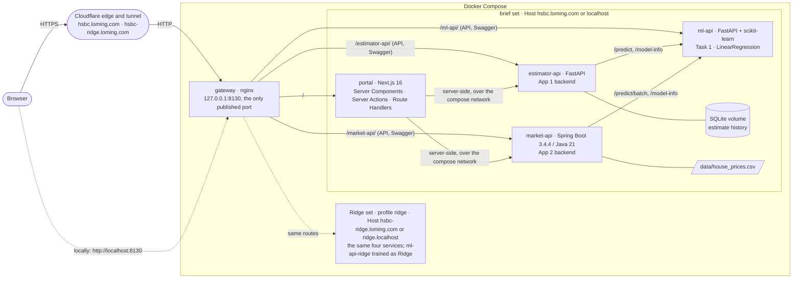
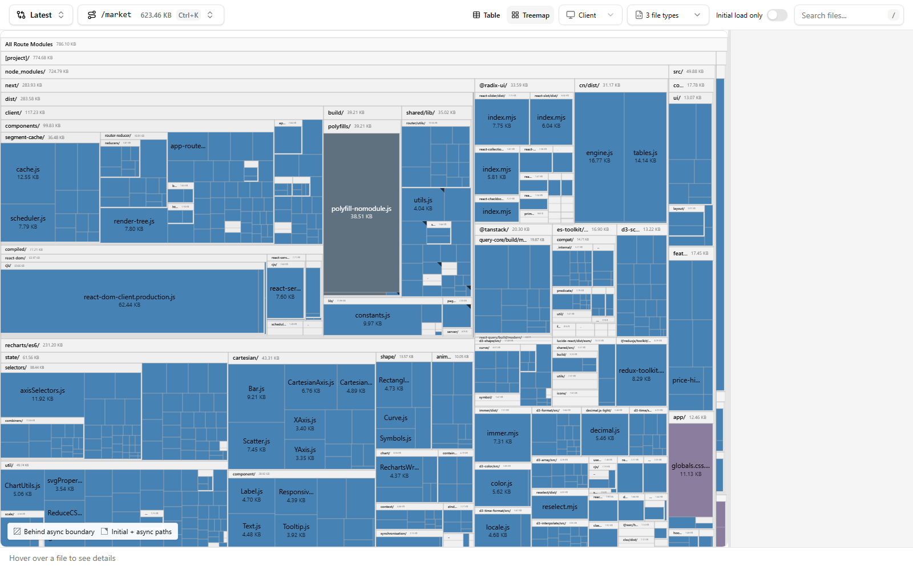

# Property Insights

A full-stack take-home in two parts:

- **Task 1, `ml-api`:** a FastAPI + scikit-learn service that predicts house prices from 7 features, with `/predict`, `/predict/batch`, `/model-info` and `/health`, shown live through Swagger.
- **Task 2, `portal`:** a Next.js portal hosting two independent apps that both use the Task 1 model: a **Property Value Estimator** (FastAPI backend, `estimator-api`) and a **Property Market Analysis** dashboard (Spring Boot 3.4.4 / Java 21 backend, `market-api`).

Everything runs with Docker Compose behind a single nginx gateway port. Two sets of the same services can run side by side:

| Set | Model | Local URL | Started by |
|---|---|---|---|
| Brief | Plain linear regression, as the brief asks | http://localhost:8130 | `docker compose up` |
| Ridge | Ridge regression whose size and quality coefficients must be positive | http://ridge.localhost:8130 | `docker compose --profile ridge up` |

The brief set does exactly what was asked. The Ridge set shows what changes when the model's coefficients have to make sense; the reasons are in the model's `/model-info` notes.

> **Status: complete.** Task 1 and both Task 2 apps (the estimator and the market analysis) run with their backends, in both sets behind the gateway, locally and at https://hsbc.loming.com and https://hsbc-ridge.loming.com.

More detail lives in [`docs/`](docs):
- [Architecture decisions](docs/adr/README.md): ten short records of what was chosen and why.
- [Hosting](docs/hosting.md): how the public URLs are served and checked.
- [Demo script](docs/demo-script.md): the live walkthrough.

[Requirements traceability](#requirements-traceability) maps each line of the brief to its code and tests, and [Limitations and next steps](#limitations-and-next-steps) says what's left.

## Quick start

Prerequisites: Docker Engine with Docker Compose 2.38 or later (Docker Desktop includes both). Nothing else is needed to run the stack.

```bash
docker compose up --build --wait
```

Then open:

| What | URL |
|---|---|
| Portal (Task 2) | http://localhost:8130/ |
| Task 1 Swagger (`ml-api`) | http://localhost:8130/ml-api/docs |
| App 1 backend Swagger (`estimator-api`) | http://localhost:8130/estimator-api/docs |
| App 2 backend Swagger (`market-api`) | http://localhost:8130/market-api/swagger-ui.html |

For the Ridge set, add `--profile ridge` (or set `COMPOSE_PROFILES=ridge` in `.env`) and use `ridge.localhost` instead of `localhost`. To change the port, copy `.env.example` to `.env` and set `GATEWAY_PORT`.

On a fresh machine the first build downloads the base images and dependencies. In CI, building and starting both sets takes under three minutes.

## Architecture



- **One way in.** The gateway is the only published port. The Host header picks the set and the path prefix picks the service ([ADR 0002](docs/adr/0002-one-nginx-gateway.md)).
- **The browser talks only to the portal.** The portal's server code calls the backends directly over the compose network, never through the gateway, so there's no CORS and no backend address in the browser ([ADR 0004](docs/adr/0004-one-portal-two-independent-apps.md)).
- **The model is reached only through Task 1's HTTP API.** Both Task 2 backends call `ml-api`; neither loads the model itself.
- **Two sets, one codebase.** The Ridge set runs the same images with `-ridge` service names, and each set calls only its own services ([ADR 0001](docs/adr/0001-plain-linear-regression-and-a-ridge-set.md)).
- **Failures stay local.** The market dashboard doesn't need the model; stopping `ml-api` breaks only what prices homes, each with its own message.

## Task 1: the model API (`ml-api`)

| Endpoint | What it does |
|---|---|
| `POST /predict` | One property → predicted price, plus `warnings`. Add `?explain=true` for each feature's contribution relative to the average home. |
| `POST /predict/batch` | 1–1,000 properties in one call; predictions come back in input order with a 0-based `index`. The Swagger example is the provided test file. |
| `GET /model-info` | Model type and version, per-unit coefficients, cross-validated metrics against a predict-the-mean baseline, training ranges, and notes on reading the coefficients. |
| `GET /health` | 200 when the model is loaded; 503 if it failed to load, so Docker marks the container unhealthy. |

**The two models.** Both use all 7 features and are trained when the image is built (`MODEL_KIND` build arg), then evaluated with 5-fold cross-validation repeated 20 times:

| Set | Model | CV R² | CV RMSE | CV MAE |
|---|---|---|---|---|
| Brief | Plain linear regression (`LinearRegression`) | 0.972 | $10.5k | $7.6k |
| Ridge | Ridge, α = 3: the most accurate α whose size and quality coefficients are all positive | 0.976 | $10.9k | $9.6k |
| — | Predict-the-mean baseline | −0.19 | $80.5k | $70.3k |

The features are strongly correlated with each other, so plain linear regression predicts well but gives square footage (−$103 per sq ft) and bedrooms negative coefficients: lot size carries the size signal instead. The brief set serves it as asked, with that explained in `/model-info`. The Ridge set gives up about $400 of RMSE for coefficients that all point the expected way.

**Guard rails.**
- **Validation:** every field is required and range-checked, and unknown fields are rejected.
- **Warnings:** inputs outside the training range get an `OUTSIDE_TRAINING_RANGE` warning, and in-range inputs whose combination is unlike any training home get `UNUSUAL_COMBINATION`.
- **Prices at or below $0:** rejected with a 422 `outside-model-domain` problem rather than clamped. Plain linear regression hits this for a 4,100 sq ft median home.
- **Errors:** every error is RFC 9457 `application/problem+json` with a `request_id`, which also comes back as the `X-Request-ID` header.

**Develop and test** (needs [uv](https://docs.astral.sh/uv/) 0.11.28):

```bash
cd ml-api
uv sync
uv run pytest
uv run python -m ml_api.training.train --kind ols --out artifacts
```

## App 1 backend: the estimator API (`estimator-api`)

FastAPI with SQLAlchemy 2.1 (async, SQLite on a named volume). Each estimate is priced by the Task 1 model and saved, so the portal can show a history and compare properties.

| Endpoint | What it does |
|---|---|
| `POST /api/v1/estimates` | Validates the input (the same limits as `ml-api`, kept in sync by a contract test), prices it through `ml-api` with per-feature contributions, and saves it. Nothing is saved if the model call fails. |
| `GET /api/v1/estimates` | The history, newest first, paged (`limit`, `offset`), with a `total`. |
| `GET /api/v1/estimates/{id}` | One estimate. |
| `GET /api/v1/estimates/compare?ids=…&ids=…` | 2–4 estimates side by side, with each feature's min and max for highlighting, and `missing_ids` for any that were deleted. |
| `DELETE /api/v1/estimates/{id}` | Deletes one estimate. Clearing the whole history (`DELETE /api/v1/estimates`) works only inside the compose network: the public gateway refuses it. |
| `GET /api/v1/model-info` | `ml-api`'s metadata, cached for 5 minutes and served stale while `ml-api` is down. |
| `GET /health` | 200 while the database works, reporting `ml_api` as `up` or `down`. |

**When the model fails**, nothing is saved, and the error says why:
- **The model rejects the input:** its 422 passes through, with field names under `features.*`.
- **The model answers with an error** or something unreadable: 502 `model-error`.
- **The model is unreachable, times out or has no model loaded:** 503 `model-unavailable`. Calls have a 2 s connect and 5 s read timeout, and only connection failures are retried, twice.

The history and comparison keep working while `ml-api` is down.

Each set has its own history: the Ridge set's `estimator-api-ridge` calls `ml-api-ridge` and keeps its own volume.

## App 2 backend: the market API (`market-api`)

Spring Boot 3.4.4 on Java 21 (records, pattern-matching `switch`, virtual threads), with Caffeine caching and springdoc. Spring Boot 3.4 is out of open-source support; the brief pins it, and production would move to a supported line (4.1.x) or run 3.4 under commercial support.

| Endpoint | What it does |
|---|---|
| `GET /api/v1/market/summary` | Count, price mean, median, quartiles, min and max, and mean price per sq ft |
| `GET /api/v1/market/segments?by=` | Per segment (`bedrooms`, `bathrooms`, `decade`, `school_band`, `distance_band`): count, mean and median price, price per sq ft |
| `GET /api/v1/market/segments/medians?by=` | Each segment's median home, rounded to values the model accepts: the what-if baselines |
| `GET /api/v1/market/distribution?metric=&bins=` | Histogram of price or price per sq ft |
| `GET /api/v1/market/correlations` | Each feature's correlation with price |
| `GET /api/v1/market/properties?sort=&page=&size=` | The rows, sorted and paged, with price per sq ft |
| `GET /api/v1/market/filter-options` | Ranges and values for building the filter UI |
| `POST /api/v1/market/what-if` | A baseline home and a changed one, priced by the Task 1 model in one call: delta, delta %, warnings |
| `POST /api/v1/market/what-if/sensitivity` | One feature swept over 2–50 steps in one model call |
| `GET /api/v1/market/model-info` | The model's metadata, cached, so App 2 never depends on App 1's backend |
| `GET /api/v1/market/export/csv`, `/export/pdf` | The filtered view as CSV or a PDF report |

Every statistics endpoint and export takes the same snake_case segment filters: `bedrooms` (repeatable), `min_`/`max_` `price`, `sqft`, `year`, `bathrooms`, `school_rating` and `distance`.

**Caching.**
- **Statistics:** cached with no expiry, since the dataset never changes while the app runs, and keyed by the immutable filter record.
- **What-if:** cached for 10 minutes, keyed by the request and the model version, so a retrained model never serves old prices. Failures are never cached.
- **HTTP:** statistics responses carry `Cache-Control: max-age=300` and ETags. Exports are `no-store`.
- **Evidence:** cache statistics are at `/actuator/caches` and `/actuator/metrics/cache.gets`.

**Errors** are problem+json in the same shape as the Python services. Validation is a 400 with snake_case field names. The model's failures map as in `estimator-api` (422, 502, 503), and a home the model can't price is named in the error.

**Build and test without installing a JDK**, using Maven inside the JDK image (the volume keeps Maven's downloads):

```bash
docker run --rm -v "${PWD}:/repo" -v market-api-m2:/root/.m2 -w /repo/market-api eclipse-temurin:21.0.13_9-jdk-resolute sh mvnw -B verify
```

## Task 2 portal (`portal`)

Next.js 16.4 (App Router, React 19.3) with Tailwind 4 and shadcn/ui on Radix. One portal hosts both apps: `/estimator` (App 1) and `/market` (App 2), each with its own layout, sub-navigation, loading skeletons, error boundary and not-found page.

**App 1, the Property Value Estimator:**

- **Estimate** (`/estimator`). A form for the seven model inputs, starting from a typical home, with each field's training range as a hint. It validates in the browser with the same Zod schema the Server Action uses on the server; errors appear by each field and in a summary that links to them, and focus moves to the first. The result shows the price, the model's warnings, the inputs as a table and where the price sits among the 50 training sales. The Ridge set also shows what each feature adds to or takes from the average home's price. A home the brief model prices at $0 or less gets a plain message instead.
- **History** (`/estimator/history`). Every estimate is saved by `estimator-api`, newest first, ten a page. Delete asks for confirmation in the row and removes the row at once (React's `useOptimistic`), putting it back with a message if the delete fails. Each estimate has its own page.
- **Compare** (`/estimator/compare?ids=…`). A Compare toggle on each estimate adds it to a tray of up to four, kept in `localStorage` (a Zustand store). The comparison puts the estimates in columns, marks the highest and lowest value in every row that differs, and charts the prices and each feature's place in the training range. The ids are in the URL, so a comparison can be bookmarked; estimates deleted since are reported and dropped from the tray.

**App 2, the Property Market Analysis:**

- **Filters.** Bedrooms and six ranges (price, living area, bathrooms, year built, school rating, distance), as sliders bounded by the data. They live in the URL under the same names market-api takes, so a link shares the view and the server applies it; the Dashboard and Data tabs carry them across. A change keeps focus on the control, shows the new values at once (`useOptimistic`) and dims the results under a progress bar until the server's page arrives.
- **Dashboard** (`/market`). Headline figures, the median price by bedrooms, bathrooms, decade, school rating or distance, the spread of prices (or prices per sq ft), and price against living area for every home, with bedroom counts marked by colour and shape. Each widget fetches its own data in a Server Component and streams in behind its own Suspense and error boundary (`catchError`), so one failure shows a retry for that widget alone.
- **Data** (`/market/data`). The filtered homes in a table: any column sorts from its header (`aria-sort`, kept in the URL), a search box matches any value, and pages hold 10, 25 or 50. On a phone the table scrolls inside its box with the home number pinned. Export downloads market-api's CSV, or a PDF report with the summary and segments, of the filtered homes in the table's order, through a Route Handler that streams the file; the search box doesn't narrow exports, and the menu says so.
- **What-if** (`/market/what-if`). Start from a typical home (each bedroom segment's median) or any home in the data, move the sliders, and see the model's price and the change, "holding the other features constant". Requests are debounced and cached by their inputs (TanStack Query). Both models are linear, so the change is broken down as change × coefficient, and the figures add up; the leverage warning appears when a combination leaves the data. On the brief set, it says why more living area can lower the price. The Ridge set adds a line of the price across one feature's range, from one batch call. With the model down, the page still opens and says the model isn't answering, while the dashboard and table, which don't need it, keep working.

**Throughout:**

- **Independent apps.** Server code reaches each backend directly over the compose network, never through the gateway. App 1's code may only use `estimator-api`, App 2's only `market-api`, and an ESLint rule rejects cross-app imports. With either backend stopped, that app shows its own error panel (with "Try again", which re-fetches) while the shell and the other app keep working; the browser tests check this.
- **Data loading.** Pages load in Server Components through one server-only fetch wrapper. It waits for the request (so nothing is prerendered during `docker build`), sends a request ID, times out, and turns any failure into the backend's problem+json. Caching is chosen per data type: model info for an hour, market aggregates for 5 minutes, live status never.
- **One image, two sets.** The set (`APP_VARIANT`) and the backend URLs are server-only runtime variables, validated on first use, so the same image serves the brief set and the Ridge set; the header shows which, with a link to the other.
- **Accessibility.** WCAG 2.2 AA is the target: skip link, landmarks, `aria-current` navigation, visible focus with 3:1 contrast, colour never the only signal, focus kept clear of the sticky header, and page transitions (React's `<ViewTransition>`) that switch off under `prefers-reduced-motion`. Every chart is a captioned figure with a table view, and its colours (Okabe-Ito) stay distinct under colour blindness. axe runs on every page in CI, and again along both apps' flows; keyboard-only walks check where focus lands at every step (see [Quality](#quality-security-and-accessibility)).

**Develop and test** (Node 24.22.2, see `.nvmrc`), with the stack running for the browser tests:

```bash
cd portal
npm ci
npm run lint
npm run typecheck
npm test
npx playwright install chromium
npm run e2e
```

For `npm run dev`, point `ESTIMATOR_API_URL` and `MARKET_API_URL` at the gateway (`http://localhost:8130/estimator-api` and `http://localhost:8130/market-api`); for the Ridge set, use `ridge.localhost:8130` and set `APP_VARIANT=ridge`. Through the gateway, the dev server's calls share its rate limit of 100 per second, which the containers' direct calls don't.

## Quality, security and accessibility

**Tests at every layer.** All of these run in CI ([`.github/workflows/ci.yml`](.github/workflows/ci.yml)) on every push:

| Level | What runs |
|---|---|
| Unit and integration | **ml-api** (pytest, both model kinds): training, warnings, every endpoint. **estimator-api** (pytest, with `ml-api` stubbed by `httpx2.MockTransport`). **market-api** (JUnit, MockMvc, MockRestServiceServer). **portal** (Vitest): schemas, formatters, filters, the table model, the what-if arithmetic, the fetch wrapper. |
| Contract | Each consumer's feature limits are checked against `ml-api`'s definition. The Swagger UI's query names are checked to bind. |
| Through the gateway | Both sets are built and started with Docker Compose, smoke-tested with `curl` on both Host headers, then tested in Chromium with Playwright ([`portal/e2e`](portal/e2e)). Each app is tested again with the other app's backend stopped. |

**Accessibility (WCAG 2.2 AA).**
- **Automated checks.** axe (`wcag2a` to `wcag22aa`) runs on every page and along both apps' flows.
- **Keyboard only.** [`portal/e2e/keyboard.spec.ts`](portal/e2e/keyboard.spec.ts) drives both apps with the keyboard alone: the estimate form and its error summary, the history's delete confirmation, the comparison tray, the market filters, sorting, paging, the export menu and the what-if sliders. Every stop on the way must show a focus indicator and stay clear of the sticky header and the comparison tray. This pass found, and the fixes cover:
  - the what-if resets dropping focus;
  - the tray hiding a focused row;
  - an unpadded skip link.
- **Small screens.** Every page reflows without sideways scrolling at 320 px (400% zoom), 375 px, 768 px and 1024 px.

**Dependencies and images.**
- **Python and Node.** `pip-audit` checks the Python services' runtime dependencies, and `npm audit` the portal's.
- **Every built image.** OSV-Scanner reads each image as it ships: the Python wheels, the Spring Boot jar's libraries, the portal's `node_modules` and the OS packages. A finding fails the build unless [`osv-scanner.toml`](osv-scanner.toml) sets it aside with a reason:
  - **OS packages from the pinned base images:** fixed by refreshing the base image, not here.
  - **Two Spring Framework advisories:** fixed only in Spring 7, for features `market-api` doesn't use.
- **Spring Boot 3.4.4.** It is pinned as the brief asks; its vulnerable libraries are moved to the latest release of their own line ([ADR 0006](docs/adr/0006-spring-boot-3-4-4-with-same-line-patches.md)).
- **What runs in the containers.** Every service is non-root, with a read-only filesystem, all Linux capabilities dropped and `no-new-privileges`. The Python images drop the base image's unused `pip`.

**Bundle size.** `next analyze` (Turbopack's analyzer) shows each route's client JavaScript:

| Route | Client JS (uncompressed) |
|---|---|
| `/` | 409 KB |
| `/estimator/history` | 456 KB |
| `/market/data` | 475 KB |
| Chart routes (`/estimator`, `/estimator/compare`, `/market`, `/market/what-if`) | 611–642 KB |

These figures include a 39 KB polyfill that only browsers without ES modules load. What the analysis shows:
- Recharts loads only on the routes that draw charts.
- Zod loads only on the estimator's routes: the form, and the comparison tray's check of what it reads back from `localStorage`.
- No PDF or CSV library reaches the browser.



## Requirements traceability

Each line of the brief, how it's met, and where to look. Paths are relative to each service's folder.

**Task 1: the model API**

| ID | Requirement | Where | Evidence |
|---|---|---|---|
| T1-1 | `predict`, single and batch | `ml-api` [`api/predict.py`](ml-api/src/ml_api/api/predict.py) | [`test_api.py`](ml-api/tests/test_api.py); Swagger examples include the 10 test-file rows |
| T1-2 | `model-info`: coefficients and metrics | [`api/model_info.py`](ml-api/src/ml_api/api/model_info.py), [`training/train.py`](ml-api/src/ml_api/training/train.py) | [`test_training.py`](ml-api/tests/test_training.py) checks the coefficients against the planning analysis |
| T1-3 | `health` | [`api/health.py`](ml-api/src/ml_api/api/health.py), Docker `HEALTHCHECK` | `test_health`, `test_missing_model_reports_unavailable` |
| T1-4 | Python 3.12+, FastAPI, scikit-learn | [`pyproject.toml`](ml-api/pyproject.toml), [`Dockerfile`](ml-api/Dockerfile) | |
| T1-5 | Build, containerise and deploy a regression model | Trained during `docker build`; served publicly ([ADR 0001](docs/adr/0001-plain-linear-regression-and-a-ridge-set.md), [ADR 0003](docs/adr/0003-public-hosting-through-a-cloudflare-tunnel.md)) | https://hsbc.loming.com/ml-api/docs |
| T1-6 | GitHub, Dockerfile, live Swagger | `/ml-api/docs` through the gateway | CI's compose job |

**Task 2: the portal**

| ID | Requirement | Where | Evidence |
|---|---|---|---|
| P-0 | Two independent apps, different backends, both using the model | `src/features/estimator` and `src/features/market`, kept apart by an ESLint rule ([`eslint.config.mjs`](portal/eslint.config.mjs)) ([ADR 0004](docs/adr/0004-one-portal-two-independent-apps.md)) | [`resilience.spec.ts`](portal/e2e/resilience.spec.ts), run with each backend stopped |
| P-1 | Shared layout and navigation | [`app/layout.tsx`](portal/src/app/layout.tsx), [`components/layout`](portal/src/components/layout) | [`shell.spec.ts`](portal/e2e/shell.spec.ts) |
| P-2 | App Router routing between and within apps | [`app/estimator`](portal/src/app/estimator), [`app/market`](portal/src/app/market) | `shell.spec.ts` |
| P-3 | Consistent design system | [`components/ui`](portal/src/components/ui), tokens in [`globals.css`](portal/src/app/globals.css) | |
| P-4 | Loading and error states at layout level | `loading.tsx`, `error.tsx` and `not-found.tsx` at the root and per app; [`widget-boundary.tsx`](portal/src/components/widget-boundary.tsx) per dashboard widget | `resilience.spec.ts`, `shell.spec.ts` |

**App 1: the Property Value Estimator**

| ID | Requirement | Where | Evidence |
|---|---|---|---|
| E-1 | A form for every model field | [`estimate-form.tsx`](portal/src/features/estimator/estimate-form.tsx), [`lib/features.ts`](portal/src/lib/features.ts) | [`estimator.spec.ts`](portal/e2e/estimator.spec.ts) |
| E-2 | Client-side validation with messages | [`schema.ts`](portal/src/features/estimator/schema.ts), shared with the Server Action; [`error-summary.tsx`](portal/src/components/form/error-summary.tsx) | `schema.test.ts`, `estimator.spec.ts`, `keyboard.spec.ts` |
| E-3 | Results as a table and a chart | [`estimate-result.tsx`](portal/src/features/estimator/estimate-result.tsx), [`price-distribution-chart.tsx`](portal/src/features/estimator/price-distribution-chart.tsx); the Ridge set adds [`contribution-chart.tsx`](portal/src/features/estimator/contribution-chart.tsx) | `estimator.spec.ts` |
| E-4 | History of previous estimates | [`history-table.tsx`](portal/src/features/estimator/history-table.tsx); `estimator-api` [`repository.py`](estimator-api/src/estimator_api/repository.py) ([ADR 0007](docs/adr/0007-estimate-history-in-sqlite.md)) | [`test_estimates.py`](estimator-api/tests/test_estimates.py), `estimator.spec.ts` |
| E-5 | Side-by-side comparison | [`compare-tray.tsx`](portal/src/features/estimator/compare-tray.tsx), [`comparison-view.tsx`](portal/src/features/estimator/comparison-view.tsx), [`comparison-charts.tsx`](portal/src/features/estimator/comparison-charts.tsx) | `estimator.spec.ts`, `keyboard.spec.ts` |
| E-6 | A Python backend handles submissions | `estimator-api` [`api/estimates.py`](estimator-api/src/estimator_api/api/estimates.py), called by the Server Action [`actions.ts`](portal/src/features/estimator/actions.ts) | `test_estimates.py` |
| E-7 | Integrates with the model container | [`ml_client.py`](estimator-api/src/estimator_api/ml_client.py) | `test_model_failures_map_to_problems_and_save_nothing`; CI's compose job |
| E-8 | Validation and error handling | [`schemas.py`](estimator-api/src/estimator_api/schemas.py), [`api/problems.py`](estimator-api/src/estimator_api/api/problems.py) ([ADR 0009](docs/adr/0009-one-wire-contract.md)) | `test_invalid_input_is_rejected_before_any_model_call`, the contract test in [`test_system.py`](estimator-api/tests/test_system.py) |

**App 2: the Property Market Analysis**

| ID | Requirement | Where | Evidence |
|---|---|---|---|
| M-1 | Interactive dashboard | [`app/market/page.tsx`](portal/src/app/market/page.tsx), [`dashboard-widgets.tsx`](portal/src/features/market/dashboard-widgets.tsx) | [`market.spec.ts`](portal/e2e/market.spec.ts) |
| M-2 | Filters for property segments | [`filters.ts`](portal/src/features/market/filters.ts), [`filter-bar.tsx`](portal/src/features/market/filter-bar.tsx); `market-api` [`MarketFilter.java`](market-api/src/main/java/com/propertyinsights/market/analytics/MarketFilter.java) ([ADR 0010](docs/adr/0010-where-client-state-lives.md)) | `filters.test.ts`, `MarketFilterTest`, `market.spec.ts`, `keyboard.spec.ts` |
| M-3 | What-if analysis using the model | [`what-if-panel.tsx`](portal/src/features/market/what-if-panel.tsx); [`WhatIfService.java`](market-api/src/main/java/com/propertyinsights/market/whatif/WhatIfService.java) | `what-if-model.test.ts`, `WhatIfControllerTest`, `market.spec.ts` |
| M-4 | Export as CSV and PDF | [`CsvExporter.java`](market-api/src/main/java/com/propertyinsights/market/export/CsvExporter.java), [`PdfReportExporter.java`](market-api/src/main/java/com/propertyinsights/market/export/PdfReportExporter.java), streamed by [`export/[format]/route.ts`](portal/src/app/api/market/export/[format]/route.ts) ([ADR 0008](docs/adr/0008-exports-generated-in-java.md)) | `ExportControllerTest`, `market.spec.ts` |
| M-5 | Responsive tables with sorting and filtering | [`property-table.tsx`](portal/src/features/market/property-table.tsx), [`property-table-model.ts`](portal/src/features/market/property-table-model.ts) | `property-table-model.test.ts`, `market.spec.ts` (including at phone width) |
| M-6 | REST endpoints for market analysis | [`MarketController.java`](market-api/src/main/java/com/propertyinsights/market/web/MarketController.java), [`WhatIfController.java`](market-api/src/main/java/com/propertyinsights/market/web/WhatIfController.java) | `MarketControllerTest`, `ApiContractTest` |
| M-7 | Aggregate statistics | [`MarketAnalytics.java`](market-api/src/main/java/com/propertyinsights/market/analytics/MarketAnalytics.java), [`Stats.java`](market-api/src/main/java/com/propertyinsights/market/analytics/Stats.java) | `MarketAnalyticsTest`, `StatsTest` |
| M-8 | Integrates with the model container | [`MlClient.java`](market-api/src/main/java/com/propertyinsights/market/whatif/MlClient.java) | `MlClientTest` |
| M-9 | Caching | [`CacheConfig.java`](market-api/src/main/java/com/propertyinsights/market/config/CacheConfig.java), [`HttpCachingConfig.java`](market-api/src/main/java/com/propertyinsights/market/config/HttpCachingConfig.java); the portal's fetch cache ([ADR 0005](docs/adr/0005-classic-nextjs-caching.md)) | `/market-api/actuator/caches`, `ApiContractTest` |

**Task 2: technical requirements**

| ID | Requirement | How it's met |
|---|---|---|
| TR-1a | App Router | All routing in [`portal/src/app`](portal/src/app) |
| TR-1b | Server and client components used appropriately | Server Components by default; `"use client"` only on interactive leaves: the form, charts, filters, table and sliders |
| TR-1c | Server Components for initial data | Every page loads its data on the server through [`lib/api`](portal/src/lib/api) |
| TR-1d | Proper data-fetching strategies | Server Components with Suspense streaming for reads, Server Actions for writes, Route Handlers with TanStack Query for interactive calls ([ADR 0005](docs/adr/0005-classic-nextjs-caching.md)) |
| TR-1e | Custom hooks | [`src/hooks`](portal/src/hooks): URL state, debouncing, downloads, formatters, hydration, reduced motion; per app, `useCompareTray` and `useWhatIf` |
| TR-2a | Responsive layouts | Tailwind, mobile first; checked at 320–1280 px |
| TR-2b | Accessible components | Radix primitives; axe and the keyboard walks (above) |
| TR-2c | Loading states and error boundaries | See P-4; per-widget Suspense with `catchError` and retry |
| TR-2d | Smooth transitions | `<ViewTransition>` on navigation, optimistic updates and pending states, all off under `prefers-reduced-motion` |
| TR-2e | Cohesive, modern UI | One design system and chart palette across both apps |
| TR-3a | Client-side state management | The URL, Zustand and TanStack Query, each for its own kind of state ([ADR 0010](docs/adr/0010-where-client-state-lives.md)) |
| TR-3b | Form state with validation | React Hook Form and Zod, with one schema shared with the Server Action |
| TR-3c | Efficient data fetching | Parallel fetches on the server, per-type caching, debounced what-if calls |
| TR-3d | API communication and error states | One fetch wrapper that turns every failure into a typed problem ([`client.ts`](portal/src/lib/api/client.ts)), with "Try again" on each failed section |
| TR-4a | Next.js best-practice structure | Thin route files, feature folders, a `server-only` API layer |
| C-1 | Python 3.12+, FastAPI, Java 21, Spring Boot 3.4.4 | `python:3.12.16-slim`, Temurin 21, Spring Boot 3.4.4 exactly ([ADR 0006](docs/adr/0006-spring-boot-3-4-4-with-same-line-patches.md)) |
| C-2 | GitHub and a live demo | This repository, `docker compose up`, the public URLs and the [demo script](docs/demo-script.md) |

## Limitations and next steps

**Limitations**

- **The model.** It learned from 50 homes whose features move together. Plain linear regression gives square footage and bedrooms negative coefficients, and can't price some valid-looking homes. Neither model gives a prediction interval.
- **No accounts.** Everyone shares each set's history; the gateway only refuses to clear it all at once. Cloudflare Access is the planned lock for the public URLs ([docs/hosting.md](docs/hosting.md#protection)).
- **Availability.** The public URLs depend on the demo PC being on, awake and signed in.
- **Spring Boot 3.4.4 is out of open-source support.** Its libraries are patched within their own lines, and two advisories are accepted ([ADR 0006](docs/adr/0006-spring-boot-3-4-4-with-same-line-patches.md)).
- **OS packages** in the base images are scanned but don't fail the build. Their fixes arrive with refreshed base images.
- **Accessibility** is checked by axe and the keyboard walks. A pass with a screen reader (NVDA or Narrator) is still to do.
- **Exports** don't apply the table's search box, which narrows only what's on screen. The export menu says so.

**Next steps**

- Authentication, and a history per user.
- Postgres with Alembic migrations in `estimator-api`, and a shared cache (Redis) once `market-api` runs more than one instance.
- Spring Boot 4.1, which ends the same-line patching.
- Next.js Cache Components, along the path in [ADR 0005](docs/adr/0005-classic-nextjs-caching.md).
- TypeScript types generated from the services' OpenAPI documents, instead of written by hand.
- Prediction intervals, and a model registry with a retraining pipeline.
- Splitting the portal into Next.js Multi-Zones if the two apps need separate releases ([ADR 0004](docs/adr/0004-one-portal-two-independent-apps.md)).
- Load testing, and container orchestration (Kubernetes) beyond one host.

## Repository layout

```text
├── data/            # the provided datasets: the single source of truth for training and analytics
├── gateway/         # nginx: one published port, routes to every service
├── ml-api/          # Task 1: FastAPI + scikit-learn
├── estimator-api/   # Task 2, App 1 backend: FastAPI + SQLite
├── market-api/      # Task 2, App 2 backend: Spring Boot 3.4.4 / Java 21
├── portal/          # Task 2: Next.js App Router portal
└── docs/            # decisions (adr/), hosting, demo script, images
```

## Data

`data/house_prices.csv` (50 labelled rows) and `data/test_data_for_prediction.csv` (10 unlabelled rows) are the provided files, converted to LF line endings without a byte-order mark, so the dataset hash and the model version are identical on every OS.

## Working on Windows

- `.gitattributes` stores every text file with LF endings and checks them out with LF, because they run inside Linux images. `.editorconfig` makes new files start with LF too.
- `make` isn't available on Windows; every `Makefile` target is a one-line `docker compose` command you can run directly.
