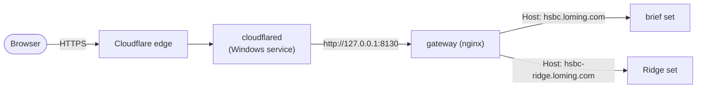

# Hosting: the public URLs

Both sets are served from the demo PC through a Cloudflare Tunnel, the reasoning for which is in [ADR 0003](adr/0003-public-hosting-through-a-cloudflare-tunnel.md). This page is how to run, change and check it.

| What | Brief set | Ridge set |
|---|---|---|
| Portal | https://hsbc.loming.com/ | https://hsbc-ridge.loming.com/ |
| Task 1 Swagger (`ml-api`) | https://hsbc.loming.com/ml-api/docs | https://hsbc-ridge.loming.com/ml-api/docs |
| App 1 backend Swagger | https://hsbc.loming.com/estimator-api/docs | https://hsbc-ridge.loming.com/estimator-api/docs |
| App 2 backend Swagger | https://hsbc.loming.com/market-api/swagger-ui.html | https://hsbc-ridge.loming.com/market-api/swagger-ui.html |
| Without the tunnel | http://localhost:8130/… | http://ridge.localhost:8130/… |

## How a request gets in



Cloudflare holds the certificate (its free certificate covers `*.loming.com`), and the tunnel carries plain HTTP to the gateway on the loopback interface. The gateway forwards the visitor's address from `CF-Connecting-IP`, so its rate limits and logs are per visitor rather than per tunnel.

## Setup on this PC

Cloudflare DNS already routes `*.loming.com` to the tunnel. The tunnel's locally managed config, `C:\cloudflared\config.yml`, has one ingress rule per hostname, both to the gateway, before the catch-all 404:

```yaml
  - hostname: hsbc.loming.com
    service: http://127.0.0.1:8130
  - hostname: hsbc-ridge.loming.com
    service: http://127.0.0.1:8130
```

The repository's `.env` (git-ignored) on this PC starts both sets, and points each set's "switch" link at the other public hostname:

```text
GATEWAY_PORT=8130
COMPOSE_PROFILES=ridge
BRIEF_PUBLIC_URL=https://hsbc.loming.com
RIDGE_PUBLIC_URL=https://hsbc-ridge.loming.com
```

Start or update everything (containers restart on their own unless stopped):

```bash
docker compose up -d --build --wait
```

## What a change needs

| Change | What to run |
|---|---|
| Application code | `docker compose up -d --build --wait <service> <service>-ridge` |
| Gateway config (routes, limits, error pages) | `docker compose restart gateway`. `nginx -s reload` rejects a changed rate-limit key and keeps the old config, logging only an `[emerg]` line. |
| A new path under an existing hostname | A gateway change only. The tunnel forwards every path. |
| A new hostname | Add an ingress rule, test it with `cloudflared tunnel --config C:\cloudflared\config.yml ingress rule https://<host>`, then run `Restart-Service Cloudflared` in an **elevated** PowerShell. The restart briefly drops every site on the tunnel. |

## Checking it

Each hostname must reach its own set:

```bash
curl -s https://hsbc.loming.com/ml-api/health
```

```bash
curl -s https://hsbc-ridge.loming.com/ml-api/health
```

The first reports a `model_version` starting with `ols-`, the second one starting with `ridge-`. A 404 with `server: cloudflare` means the tunnel hasn't picked up the hostname: restart the service. A 502 from Cloudflare means the gateway isn't running.

The browser suite runs against the public URLs too. Run it from `portal/`. It deletes the estimates it saves.

```bash
E2E_BASE_URL=https://hsbc.loming.com E2E_RIDGE_URL=https://hsbc-ridge.loming.com npx playwright test
```

## Protection

- **Exposure.** Only the gateway's port is published, and only on `127.0.0.1`. The containers run as non-root users on read-only filesystems, with every Linux capability dropped.
- **Rate limits, per visitor:** API calls 100 a second (bursts of 400), page loads 200 a second (bursts of 600), link prefetches 500 a second (bursts of 2,000). Over the limit, a visitor gets a 429: problem+json from the APIs, a short HTML page from the portal.
- **Request bodies:** at most 1 MB.
- **The history:** clearing it all at once (`DELETE /estimator-api/api/v1/estimates`) is refused publicly; deleting one estimate at a time works.
- **Cloudflare Access is not on yet.** Before the links are shared, add one self-hosted application in Cloudflare Zero Trust covering both hostnames, with a one-time-PIN policy for the reviewers' addresses (or their email domain) and your own. Without it, the rate limits are the only protection, and anyone with the link can add to the history.

## The review window

The URLs work only while this PC is on, awake and signed in: Docker Desktop starts at sign-in, not at boot, so after a restart for updates the containers stay down until someone signs in.

| Check | State on 3 Nov 2026 |
|---|---|
| No sleep or hibernation on mains power | Done (both "never") |
| `Cloudflared` service running, starting automatically | Done |
| Docker Desktop starts at sign-in | Done |
| Windows Update paused for the review window | **To do** (Settings → Windows Update → Pause updates) |
| Cloudflare Access on both hostnames | **To do** (above) |
| Both hostnames load from a phone on mobile data | Check before sharing the links |

## Shared history

Everyone shares each set's history, the browser tests included. The tests label what they save with a run tag and delete it afterwards. Delete manual test estimates before a demo, one at a time from the History page or with `DELETE /estimator-api/api/v1/estimates/{id}` in the Swagger UI.
